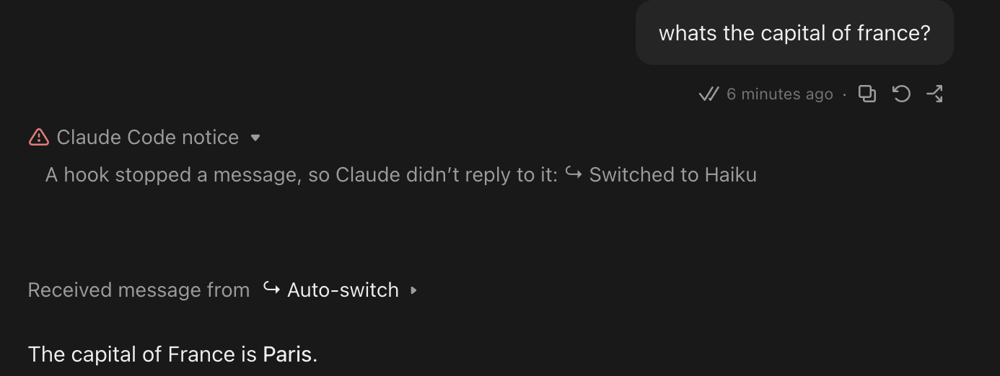
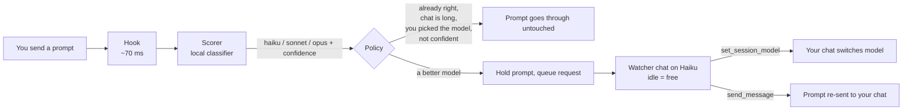

# Claude Auto Switch (Mac and Windows)

**Claude Code desktop picks the cheapest model that can handle each prompt: Haiku for the quick stuff, Opus only when it matters.**

A tiny local classifier reads every prompt you send. If a different model would do the job, your chat is switched to it and the prompt is sent again, automatically. Nothing leaves your machine.



> Measured on 150 real SWE-bench bugs: starting on Haiku and escalating only when needed cost **$0.055 per issue**, against about **$0.129** per Opus attempt ([numbers and caveats](#what-it-saves)).

> **Works only in the Code tab of the Claude desktop app** (a Local session on your own computer). It does not work in normal Chat, Cowork, claude.ai in a browser, or Cloud sessions: those have no hooks and no access to your files. No **Code** tab in your app? Update the app first; if it is still missing, Auto Switch can't run on your account.

## 60-second quickstart

macOS or Windows (see [Windows](#windows)), the Claude Code **desktop app**, and Python 3.9 to 3.13 (already on a Mac with the command line tools).

macOS:

```bash
git clone https://github.com/BR1K0/claude-autoswitch-v2.git
cd claude-autoswitch-v2
./install.sh
```

Windows (PowerShell, no administrator needed):

```powershell
git clone https://github.com/BR1K0/claude-autoswitch-v2.git
cd claude-autoswitch-v2
powershell -ExecutionPolicy Bypass -File install.ps1
```

The installer sets everything up in `~/.autoswitch` (`%USERPROFILE%\.autoswitch` on Windows), starts the scorer at login, adds the hook to `~/.claude/settings.json` (after backing it up) and starts in **shadow mode**: it only records what it *would* switch and changes nothing. Use Claude Code as usual for a day, then look:

```bash
autoswitch report      # how many prompts would have switched, and to what
```

Happy with it? Turn it on:

```bash
autoswitch on
```

Then open a new chat in the **Code tab** of the desktop app, set it to run **Local** on your own computer (not Cloud or Remote), choose **Haiku**, and paste the Watcher prompt (printed by the installer, or any time with `autoswitch watcher`). Leave that chat open. That's it.

> The Watcher must run on your own machine. A regular claude.ai chat or a Cloud session runs on a remote Linux box with no access to `~/.autoswitch`, and will say "the watcher script isn't present".

| Command | Does |
|---|---|
| `autoswitch status` | mode, scorer, hook, Watcher at a glance |
| `autoswitch shadow` | log only, change nothing (default) |
| `autoswitch on` | switch models for real |
| `autoswitch hint` | only show a "Router suggests: Haiku" note |
| `autoswitch off` | do nothing at all |
| `autoswitch report` | summary of the shadow log |
| `autoswitch watcher` | print the Watcher prompt |
| `autoswitch speed [instant\|seamless]` | how `on` switches (no argument: print it). See [Speed](#speed-instant-vs-seamless) |

Running `autoswitch` with no argument is the same as `status`. `autoswitch help` lists the commands.

See [Uninstall](#uninstall) to remove it.

## How it works



1. A `UserPromptSubmit` hook scores your prompt with a small local model (TF-IDF + logistic regression, about 6 ms).
2. A policy decides whether switching is worth it. It needs high confidence to go *down* (70%) and only moderate confidence to go *up* (50%), because leaving a hard question on a weak model is the costlier mistake. A prompt that is unclear moves the chat to Sonnet (set `AUTOSWITCH_UNCLEAR=stay` to turn this off). It never touches a chat whose model you picked by hand; and it leaves long chats alone, because changing model throws away the prompt cache and re-reading a big history costs more than it saves.
3. If it switches (with the default `seamless` speed), the hook holds your prompt and writes a request. The **Watcher**, a Haiku chat running a shell loop that costs nothing while idle, changes your chat's model and re-sends your prompt. You see "Switching to Haiku…" and then the answer. With `instant` speed the prompt is never held: it is answered on the current model and the Watcher only switches the chat for your next message (see [Speed](#speed-instant-vs-seamless)).
4. A prompt with a pasted screenshot is never held (the re-send would lose the image). It is answered on the current model, and the chat switches for your *next* message. Text inside the screenshot is read locally with macOS Vision and scored too (on Windows the screenshot is detected but not read yet, so the prompt is scored on your typed text alone).

Nothing is ever lost silently: if anything fails, the prompt goes through unchanged or you are told to send it again.

## What it saves

150 SWE-bench bug-fix tasks, each run by a real agent on Haiku, then Sonnet, then Opus until one solved it (the cascade). Cost is measured API spend.

| Strategy | Cost per issue | Solved |
|---|---|---|
| **Haiku first, escalate if it fails** | **$0.055** | 130 / 150 |
| Haiku only | $0.012 | 103 / 150 (69%) |
| Opus attempt (mean over the 34 runs) | ~$0.129 | n/a |

- Of the 150, Haiku solved 103, Sonnet solved 13 of the rest and Opus solved 14 of the 34 it was given. Haiku alone solved 103 of 150, so most of the work never needed a bigger model.
- The classifier picks a starting model up front (instead of always starting on Haiku) to skip hopeless first attempts. On a small held-out check (30 issues) it did no better than always guessing Haiku, so treat it as a cheap prior, not an oracle.

**Honest caveats**
- The Opus figure comes from the 34 issues where Haiku and Sonnet had already failed, i.e. the hardest ones. Opus on the easy 116 would cost less, so "2.3x cheaper than always-Opus" overstates the saving. Real-world savings depend on your mix of prompts.
- This is an agent fixing bugs, not interactive chat. Prompts in a chat are shorter, and the cost of re-caching a switched chat is *not* in these numbers (the policy models it with estimates).
- **Switching itself costs money.** Each model keeps its own prompt cache, so after a switch the history is re-read at full price. At published Anthropic prompt-caching rates, re-caching a 50k-token chat costs about $0.006 on Haiku, $0.125 on Sonnet and $0.25 on Opus. That is why long chats stay put. The policy's per-answer savings and the Haiku re-cache figure are rough estimates that haven't been calibrated.
- The cost per issue is spend, not spend per *solved* issue. There is no measured always-Sonnet or always-Opus run on all 150.
- 150 tasks from open-source Python repositories. Your work may look different. That is why shadow mode exists: measure on your own prompts first.

## v2: long chats, handoffs and rollover (off by default)

v1 leaves long chats alone, because switching model makes the new model re-read the whole history. v2 adds a cheaper
way: a **handoff to a new chat** built by [ACPMH](acpmh/), the project memory bundled in this repo. ACPMH keeps a local
journal of the chat (every message word for word, tool calls, test runs, commits, screenshots with their text read
locally) and builds a compact handoff the new model reads instead of the full history. Part 2 can still look anything
up in the journal.

| Chat size | balanced (default) | save | quality |
|---|---|---|---|
| under ~70k tokens | switch in place (v1) | switch in place | switch in place |
| 70k-300k | new chat with the v4 handoff | v4 handoff | switch in place |
| over 300k | v5b handoff | v5 handoff | v4 handoff |

In the benchmark ([docs/BENCHMARK.md](docs/BENCHMARK.md)) a handoff scored 94-99% of re-reading at a half to a fifth
of the cost; compaction never won. A handoff only happens for a **lasting** switch (a new task, or two messages in a
row wanting the other model); a one-off message in a long chat stays put.

Also in v2:
- **Real sizes:** the history is counted from the transcript (characters / 4 x 1.6), not file bytes.
- **Budget modes:** `quality`, `balanced`, `save` (`AUTOSWITCH_BUDGET` or `~/.autoswitch/budget`), with an optional
  limit (`AUTOSWITCH_LIMIT`, e.g. `$20/week`) that nudges the mode when you spend fast.
- **Context-aware scoring:** short messages ("yes do it") are scored with the current task and your last 3 messages.
  `AUTOSWITCH_CONTEXT=off` turns it off.
- **Exactly once:** the handed-off message reaches part 2 once, with a one-time tag; "please resend" if it doesn't.
  Part 2 gets the old chat's effort, folder and permission mode, never more.
- **One Watcher:** a second Watcher stops itself.
- **Automatic rollover:** a chat over `AUTOSWITCH_ROLLOVER_AT` (200k) moves to a fresh part 2 when you send a message
  in it, at a quiet moment, with its task and scheduled jobs. Every step is saved, so a crash resumes or undoes it.
  For rollover when the agent finishes a turn on its own (overnight work), also register `hook/stop.py` as a `Stop`
  hook.

Turn on (needs `enforce` mode):

```bash
echo on > ~/.autoswitch/handoff      # handoffs, budget modes, context scoring
echo on > ~/.autoswitch/rollover     # rollover too (needs handoff on)
```

Turn off with `rm ~/.autoswitch/handoff ~/.autoswitch/rollover`: with both off, every decision is exactly v1's (tested).
ACPMH fact extraction uses Haiku and runs only if `ANTHROPIC_API_KEY` is set and the `anthropic` package is installed;
without it the handoff has the word-for-word journal only.

**Privacy:** the journal under `~/.acpmh/` keeps your chats word for word, locally. Secrets are removed only from
screenshot text, so anything typed into a chat (passwords included) is stored as typed. Never paste passwords or keys
into a chat, and keep `~/.acpmh/` private.

**Not verified live yet:** a real handoff and rollover in the app (the 300 tests use fakes), and whether a turn continued
by the Stop hook may start a new chat.

## Speed: instant vs seamless

Speed only matters once switching is on (`autoswitch on`); in shadow, hint and off nothing is switched either way. Set it with `autoswitch speed instant` or `autoswitch speed seamless`; `autoswitch speed` and `autoswitch status` show the current value.

**Fresh installs get `instant`.** The installers write `speed=instant` only when there is no `mode` file yet (a first install) and no `speed` file. An upgrade, or a speed you picked, is never overwritten. With no `speed` file at all the hook uses `seamless`, so existing installs keep behaving as before. Fresh installs still start in shadow mode.

| | `instant` | `seamless` |
|---|---|---|
| Your prompt | goes through untouched, never held | held (the turn stops with "↪ Switched to Haiku"), then re-sent by the Watcher |
| Which model answers **this** prompt | the chat's **current** model | the **new** model |
| When the switch applies | from your next message | this message |
| What the Watcher does | `set_session_model` only (`send: false`) | `set_session_model` and `send_message` |
| You see | "↪ Switching to Haiku" as a note on a normal answer | the stopped turn, then your prompt again and its answer |
| If the Watcher fails | nothing is lost: the answer already came, the chat just is not switched | a "please send it again" note on your next prompt |

The honest trade-off: **with `instant`, the first message after a change of need can hit the wrong model.** A hard question asked in a Haiku chat is answered by Haiku, and only the follow-up gets Opus; a quick question in an Opus chat still costs Opus once. `seamless` gets that first message right, but every switch costs a stopped turn, a second copy of your prompt in the chat and a wait for the Watcher to re-send it (usually a few seconds, longer if the chat is busy). The routing decision itself (gates, dwell guard, pins, new-chat rules) is the same for both.

A prompt with a pasted screenshot is always handled the `instant` way, whatever the setting: re-sending it would drop the image.

## Configuration

Set these as environment variables for Claude Code, for example in `~/.claude/settings.json`:

```json
{ "env": { "AUTOSWITCH_DOWN_THRESHOLD": "0.8" } }
```

| Variable | Default | Meaning |
|---|---|---|
| `AUTOSWITCH_DOWN_THRESHOLD` | `0.70` | confidence needed to move to a *cheaper* model |
| `AUTOSWITCH_UP_THRESHOLD` | `0.50` | confidence needed to move to a *stronger* model |
| `AUTOSWITCH_LEAN_THRESHOLD` | `0.40` | lean band: an Opus score from here up to the up gate moves a Haiku chat to Sonnet (enforce only; capped at the up gate) |
| `AUTOSWITCH_UNCLEAR` | `sonnet` | unclear prompt: move the chat to `sonnet`, or `stay` where it is |
| `AUTOSWITCH_MAX_DOWN_TOKENS` | `60000` | never switch down in a chat with more history than this (estimated tokens) |
| `AUTOSWITCH_EXPECTED_TURNS` | `5` | how many more answers a cheaper model is expected to serve |
| `AUTOSWITCH_MAX_PROMPT_CHARS` | `6000` | longer prompts are passed through |
| `AUTOSWITCH_IMAGE_WINDOW` | `300` | seconds a clipboard screenshot counts as "just pasted" |
| `AUTOSWITCH_DIR` | `~/.autoswitch` | where state lives |
| `AUTOSWITCH_PORT` | `8765` | scorer port (install time; saved in `~/.autoswitch/port`) |
| `AUTOSWITCH_MODE` | *(file)* | `off`, `shadow`, `hint` or `enforce`; overrides the mode file that `autoswitch on/off/...` writes |
| `AUTOSWITCH_SPEED` | *(file)* | `instant` or `seamless`; overrides the `speed` file that `autoswitch speed` writes. Anything else means `seamless` |
| `AUTOSWITCH_WATCHER_TTL` | `30` | seconds since the Watcher's last heartbeat before it counts as gone |

Install-time only: `AUTOSWITCH_NO_LAUNCHD=1` skips the launch agent (the scorer is then not started; on Windows `AUTOSWITCH_NO_SERVICE=1` skips the scheduled task, `AUTOSWITCH_TASK` names it), and `AUTOSWITCH_LABEL` sets the launch agent label (default `com.autoswitch.scorer`). `AUTOSWITCH_THRESHOLD` is accepted as an older name for `AUTOSWITCH_DOWN_THRESHOLD`. Advanced knobs (rough, uncalibrated estimates used by the policy in `hook/policy.py`, `hook/hint.py` and `hook/images.py`; dollar figures are per switch or per answer):

| Variable | Default | Meaning |
|---|---|---|
| `AUTOSWITCH_SAVE_OPUS_SONNET` | `0.05` | estimated saving per answer, Opus -> Sonnet |
| `AUTOSWITCH_SAVE_OPUS_HAIKU` | `0.08` | estimated saving per answer, Opus -> Haiku |
| `AUTOSWITCH_SAVE_SONNET_HAIKU` | `0.02` | estimated saving per answer, Sonnet -> Haiku |
| `AUTOSWITCH_RECACHE_HAIKU` | `0.04` | estimated cost to re-cache 50k tokens of history on Haiku |
| `AUTOSWITCH_RECACHE_SONNET` | `0.13` | same, on Sonnet |
| `AUTOSWITCH_RECACHE_OPUS` | `0.25` | same, on Opus |
| `AUTOSWITCH_READ_FRACTION` | `0.1` | cached-read price as a share of the cache-write price |
| `AUTOSWITCH_BYTES_PER_TOKEN` | `4` | bytes of transcript per token when estimating history size |
| `AUTOSWITCH_IMAGE_BUDGET` | `1.5` | seconds allowed for reading a pasted screenshot |
| `AUTOSWITCH_OCR_CHARS` | `1500` | most screenshot text passed to the scorer |

The model mapping lives in `hook/policy.py` (`MODELS`). Edit `~/.autoswitch/app/hook/policy.py` to point at other model ids.

## Limits (please read)

- **Claude Code desktop app only.** Switching uses the app's session tools. In the terminal CLI or headless runs the hook never blocks anything; it just logs.
- **A Watcher chat must stay open.** Without one, `autoswitch on` degrades to shadow behaviour (prompts are never held) and tells you so.
- **Paste screenshots, don't drag them.** Pasted images are detected through the clipboard. Dragged or uploaded images can't be seen, so a switch could drop them.
- **A long chat stays on its model.** Switching discards the prompt cache; past about 60k tokens of history that costs more than it saves, so those chats are left alone. Going *up* to a stronger model is always allowed.
- **A hand-picked model wins.** Choose a model from the menu or `/model` and Autoswitch leaves that chat alone.
- The classifier is small and trained on limited data. It will sometimes pick wrong. Escalation (up needs only 50%) is deliberately easier than downgrading (70%).
- `/commands`, agent-to-agent messages and tool notifications are never held.
- The switch adds a pause of a few seconds: two Watcher tool calls plus the app's own model change.
- Several prompts sent in a quick burst can merge into one turn.
- There's no escalation on failure yet. Going up is decided from the prompt, not from failing tests or "that's wrong".
- Live switching has only been tried on a handful of prompts on one Mac, including 2 out of 2 switches up to Opus. Remote use through claude.ai/code is untested.
- The app may ask you to approve each switch unless your permission mode allows it, especially a switch to a pricier model.

## FAQ

**Does my prompt go anywhere?** No. The scorer listens on `127.0.0.1` only. The shadow log stores lengths and decisions, never your text. The hook sends nothing off your machine.

**What does the Watcher cost?** It is a Haiku chat sitting in a shell loop. While idle it uses no tokens; each switch costs a few hundred.

**Will it mess up my settings?** The installer backs up `settings.json` to `settings.json.autoswitch-backup-<time>`, only adds its two hooks, replaces an older router hint instead of stacking a second one, and is safe to run again. `./uninstall.sh` puts back what it replaced: if you haven't edited `settings.json` since installing, the original file is restored byte for byte; otherwise any hook it replaced goes back into its original place.

**What if I close the Watcher?** With no Watcher heartbeat, prompts are never held, so nothing is lost; it just stops switching. A request that waits more than 10 minutes is dropped, and the next prompt in that chat tells you to send it again.

**The Watcher says the script "isn't present on this machine" or mentions `/home/claude`.** That chat is running in the cloud. Start a new **Local** chat in the Code tab (your own computer, not Cloud or Remote) and paste the prompt there.

**It says "no Watcher session is running".** Open a Haiku chat and paste `autoswitch watcher`'s output, or run `autoswitch shadow` if you don't want it right now.

**How is the scorer trained?** From public data only, in `data/`: 2,000 synthetic chat prompts (written by an LLM and labelled by difficulty) and 150 SWE-bench issues labelled with the cheapest model that solved each. `train/train.py` retrains it in a few seconds; the installer does this for you. No personal data is involved.

**Can I retrain it on my own prompts?** Add rows to `data/synthetic_train.jsonl` (`{"text":..., "label": "haiku|sonnet|opus"}`) and re-run `./install.sh`.

**Does it slow down sending?** The hook adds roughly 70 ms (scorer: ~6 ms, the rest is Python starting up).

**The scorer isn't running.** `autoswitch status` shows it. Logs are in `~/.autoswitch/logs/scorer.log`; `launchctl` restarts it at login and if it crashes. On Windows the logs are in `%USERPROFILE%\.autoswitch\logs\scorer.log` and a Task Scheduler task starts it at login (see [Windows](#windows)).

## Windows

CI (`.github/workflows/tests.yml`) runs the unit tests on Linux, macOS and Windows runners, a fresh-profile install on Windows, and a repeated race test. Please report what breaks.

What is different from the Mac version:

- `install.ps1` / `uninstall.ps1` do what `install.sh` / `uninstall.sh` do: private venv in `%USERPROFILE%\.autoswitch`, shadow mode on first install, `settings.json` backed up, an older router hint replaced rather than stacked, safe to run again. `uninstall.ps1 -KeepData` keeps your shadow log.
- The scorer starts at login from a Task Scheduler task (`AutoswitchScorer`, current user, limited rights, no administrator). If Task Scheduler refuses, the installer falls back to a launcher in your Startup folder. Check with `autoswitch status`.
- The hook command is written with the Python the installer found (full path, forward slashes), with no `2>/dev/null || true`. That path is pinned: if you upgrade Python and remove the old version (e.g. 3.12 to 3.13), the hook stops working until you run `install.ps1` again.
- The `autoswitch` command is `%USERPROFILE%\.autoswitch\bin\autoswitch.cmd`, added to your user PATH. Open a new terminal after installing.
- The Watcher prompt (`autoswitch watcher`) runs the Python the installer picked (`py -3.12`, `-3.11`, `-3.10`, `-3.13` or `-3.9` first, since scikit-learn 1.5.2 has wheels only for 3.9 to 3.13; `py -3` / `python` only as a last resort, with a warning) instead of `python3`, and `hook/watch.py` instead of `watch.sh`.
- Screenshots are detected through the Windows clipboard and never held, but their text is not read (no OCR yet); such prompts are scored on the typed text only.
- **Unverified:** the Claude desktop app's session records (`claude-code-sessions`) are looked up in `%APPDATA%\Claude`, and in a Microsoft Store install under `%LOCALAPPDATA%\Packages\Claude_*\LocalCache\Roaming\Claude`. This is inferred from how the app lays out its data folder on the Mac, not from documentation. If both folders exist, the first one that actually contains `claude-code-sessions` is used. If `autoswitch on` never switches, check that this folder exists, or point the hook at the right place with `AUTOSWITCH_SESSIONS`.
- **Override:** set the user environment variable `AUTOSWITCH_SESSIONS` to the full path of the `claude-code-sessions` folder (e.g. `setx AUTOSWITCH_SESSIONS "%LOCALAPPDATA%\Packages\Claude_xxxx\LocalCache\Roaming\Claude\claude-code-sessions"`, then restart Claude) to skip the detection entirely. It is also unverified that the app runs hook commands from `settings.json` through a shell that accepts the quoted-path form we write.

## Uninstall

```bash
./uninstall.sh              # removes the hook (restoring any it replaced), the launch agent and ~/.autoswitch
./uninstall.sh --keep-data  # same, but keeps your shadow log and mode in ~/.autoswitch
```

Windows: `powershell -ExecutionPolicy Bypass -File uninstall.ps1` (add `-KeepData` to keep your shadow log). It also removes the scheduled task and the PATH entry.

If restoring `settings.json` fails (for example it is no longer valid JSON), uninstall stops before deleting anything; fix the file and run it again. It also works with a custom `AUTOSWITCH_DIR` (run it with the same value). Backups of `settings.json` (`settings.json.autoswitch-backup-*`) are left in `~/.claude`. Close the Watcher chat afterwards.

## Layout

```
install.sh / uninstall.sh   one-command setup and full revert (macOS)
install.ps1 / uninstall.ps1 the same on Windows
bin/autoswitch              the control command
hook/                       UserPromptSubmit + PostModelSwitch hooks, policy, queue, Watcher helpers
                            (v2: handoff.py, rollover.py, budget.py, ctxblend.py, sizes.py, acpmh_bridge.py, stop.py)
acpmh/                      ACPMH: the chat journal and handoff builder v2 uses (also usable on its own)
docs/BENCHMARK.md           how the v2 defaults were measured
scorer/scorer.py            the local scoring service
train/train.py, data/       training script and the public data it uses
WATCHER.md                  the prompt for the Watcher chat
tests/                      python3 -m unittest discover -s tests   (python -m ... on Windows)
```

## License

MIT. SWE-bench issue texts in `data/swe_labeled.jsonl` come from the public [SWE-bench](https://www.swebench.com/) dataset and remain under their original project licences.


## Manual pins and the unclear default
**Manual pins.** Any model change nobody here made pins the chat. On every prompt the hook remembers the chat's model. If it now differs from the last one seen AND from the model the Watcher last asked for, a person changed it (the desktop picker or `/model`), and the chat is pinned. A pinned chat is never switched again by Autoswitch, up or down, new chats included, until the pin is cleared. This does not depend on PreModelSwitch/PostModelSwitch.
- The Watcher's own change never pins a chat: its target is recorded before the switch.
- Clear pins: `autoswitch unpin` (all chats) or `autoswitch unpin <app id>`.
- Limit: a change by hand to the very model the Watcher last asked for is not seen.

**Unclear default.** When no tier passes its gate, the move to Sonnet (enforce mode only) now applies only to a new or short chat (history up to `AUTOSWITCH_SHORT_CHAT_TOKENS`, default 20000). Long chats stay put, and so does a chat whose history size is unknown (an unreadable transcript).

**Lean band.** In enforce mode, an Opus score of at least `AUTOSWITCH_LEAN_THRESHOLD` (default 0.40) but below the up gate moves a Haiku chat one tier up, to Sonnet. Same limits as the Sonnet default: short chats only, and `AUTOSWITCH_UNCLEAR=stay` turns the band off too. Shadow mode never shows it.

**Bad settings.** A threshold or estimate that isn't a finite number (for example `"40%"`) is ignored with a warning on stderr and the default is used; routing keeps working.

**Unknown history.** An unreadable transcript counts as unknown, not as empty: no down-switch and no Sonnet default.

**Token estimate.** Transcript bytes / 4 can badly overcount a compacted chat, because the transcript keeps the whole history after compaction. This errs towards staying, so it is left as is.
